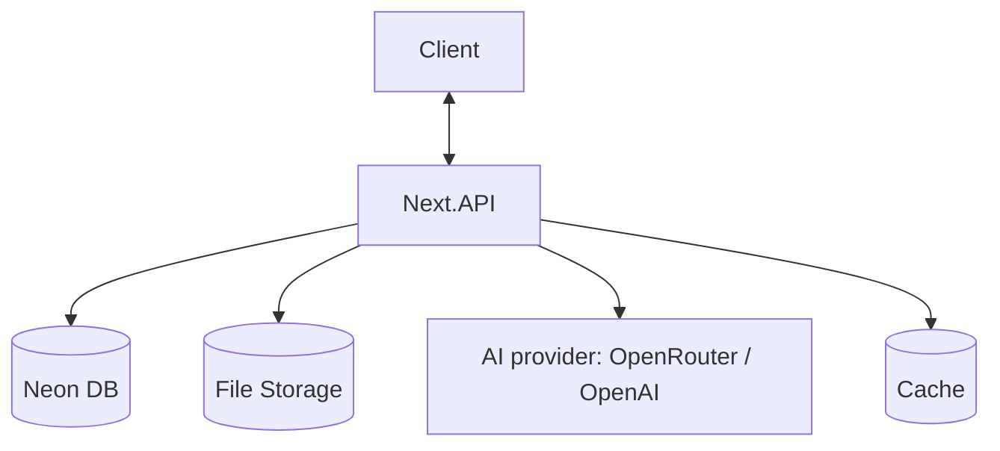
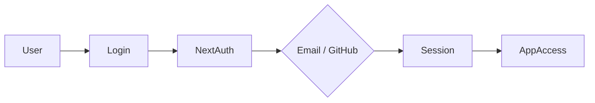
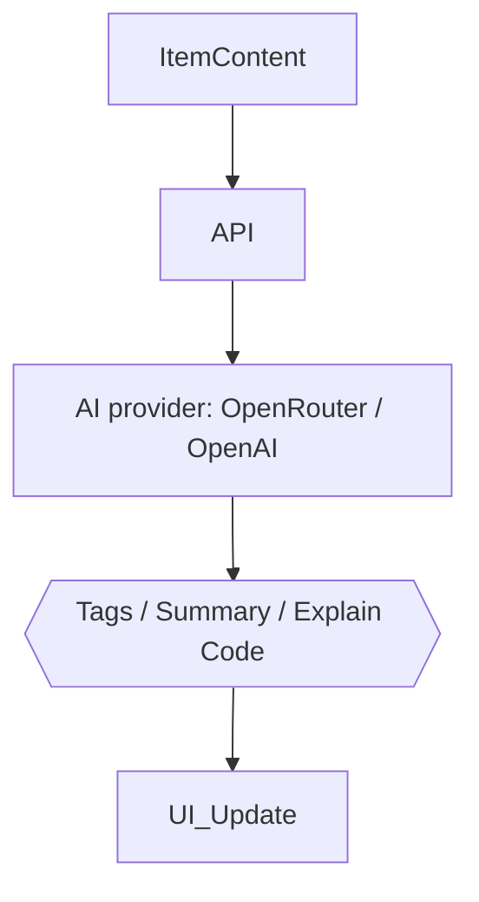

## CodStash Project Specifications

🚀 Centralized Developer Knowledge Hub

---

## CodStash Project Specifications

🚀 **Centralized Developer Knowledge Hub** for code snippets, AI prompts, docs, commands & more.

---

## 📌 Problem (Core Idea)

Developers keep their essentials scattered:

- Code snippets in VS Code or Notion
- AI prompts in chats
- Context files buried in projects
- Useful links in bookmarks
- Docs in random folders
- Commands in .txt files
- Project templates in GitHub gists
- Terminal commands in bash history

This creates **context switching, lost knowledge** and **inconsistent workflows**.

➡️ **CodStash provides ONE searchable, AI‑enhanced hub for all dev knowledge & resources.**

---

## 🧑‍💻 Users

| Persona                    | Needs                                     |
| -------------------------- | ----------------------------------------- |
| Everyday Developer         | Quick access to snippets, commands, links |
| AI‑First Developer         | Store prompts, workflows, contexts        |
| Content Creator / Educator | Save course notes, reusable code          |
| Full‑Stack Builder         | Patterns, boilerplates, API references    |

---

## ✨ Core Features

### A) Items & System Item Types

Items can belong to one of the following built‑in types:

- Snippet
- Prompt
- Note
- Command
- File
- Image
- URL

Custom types allowed for Pro users.

### B) Collections

Organize items—mixed item types allowed.

Examples:

- React Patterns
- Context Files
- Python Snippets

### C) Search

Full‑text search across:

- Content
- Tags
- Titles
- Types

### D) Authentication

- Email + Password
- GitHub OAuth

### E) Additional Features

- Favorites & pinned items
- Recently used
- Import from files
- Markdown editor for text items
- File uploads (images, docs, templates)
- Export (JSON / ZIP)
- Dark mode (default)

### F) AI Superpowers

- Auto‑tagging
- AI summaries
- Explain Code
- Prompt optimization

> AI powered by **OpenRouter `nvidia/nemotron-3-ultra-550b-a55b:free`** for now, switching to **OpenAI GPT-6 Luna** (`AI_PROVIDER=openai`) once the OpenAI account has credits

---

## 🗄️ Data Model (Rough Prisma Draft)

> This schema is a starting point and **will evolve**

```prisma
model User {
  id                   String   @id @default(cuid())
  email                String   @unique
  password             String?
  isPro                Boolean  @default(false) // mirror of proUntil, for display only
  proUntil             DateTime? // Pro while proUntil > now; each payment extends it
  payments             Payment[]
  items                Item[]
  itemTypes            ItemType[]
  collections          Collection[]
  tags                 Tag[]
  createdAt            DateTime @default(now())
  updatedAt            DateTime @updatedAt
}

// One Bictorys checkout; `reference` is the paymentReference sent to Bictorys.
model Payment {
  id            String        @id @default(cuid())
  reference     String        @unique
  userId        String?       // SetNull: payments are kept when the account is deleted
  user          User?         @relation(fields: [userId], references: [id], onDelete: SetNull)
  plan          BillingPlan   // MONTHLY | YEARLY
  amount        Int           // major units, as charged
  currency      Currency      // the currency actually charged (XOF for EUR/USD prices today)
  status        PaymentStatus @default(PENDING) // PENDING | SUCCEEDED | FAILED | NEEDS_REVIEW
  transactionId String?       @unique // Bictorys transaction id, set by the webhook
  paidAt        DateTime?
  createdAt     DateTime      @default(now())
  updatedAt     DateTime      @updatedAt
}

model Item {
  id          String   @id @default(cuid())
  title       String
  contentType String   // text | file
  content     String?  // used for text types
  fileUrl     String?
  fileName    String?
  fileSize    Int?
  url         String?
  description String?
  isFavorite  Boolean  @default(false)
  isPinned    Boolean  @default(false)
  language    String?

  userId      String
  user        User @relation(fields: [userId], references: [id])

  typeId      String
  type        ItemType @relation(fields: [typeId], references: [id])

  collections ItemCollection[] // an item can sit in several collections

  tags        ItemTag[]

  createdAt   DateTime @default(now())
  updatedAt   DateTime @updatedAt
}

model ItemType {
  id       String   @id @default(cuid())
  name     String
  icon     String?
  color    String?
  isSystem Boolean  @default(false)

  userId   String?
  user     User? @relation(fields: [userId], references: [id])

  items    Item[]
}

model Collection {
  id          String   @id @default(cuid())
  name        String
  description String?
  isFavorite  Boolean  @default(false)

  userId      String
  user        User @relation(fields: [userId], references: [id])

  items       ItemCollection[]
  createdAt   DateTime @default(now())
  updatedAt   DateTime @updatedAt
}

model Tag {
  id     String @id @default(cuid())
  name   String
  userId String
  user   User @relation(fields: [userId], references: [id])

  items  ItemTag[]
}

model ItemCollection {
  itemId       String
  collectionId String
  addedAt      DateTime @default(now())

  item       Item       @relation(fields: [itemId], references: [id], onDelete: Cascade)
  collection Collection @relation(fields: [collectionId], references: [id], onDelete: Cascade)

  @@id([itemId, collectionId])
}

model ItemTag {
  itemId String
  tagId  String

  item Item @relation(fields: [itemId], references: [id])
  tag  Tag  @relation(fields: [tagId], references: [id])

  @@id([itemId, tagId])
}
```

---

## 🧱 Tech Stack

| Category     | Choice                       |
| ------------ | ---------------------------- |
| Framework    | **Next.js 16 (App Router, Turbopack), React 19** |
| Language     | TypeScript                   |
| Database     | Neon PostgreSQL + Prisma ORM |
| Caching      | Upstash Redis (rate limiting) |
| File Storage | Cloudflare R2                |
| CSS/UI       | Tailwind CSS v4 + ShadCN     |
| Auth         | NextAuth v5 (email + GitHub) |
| Email        | Resend                       |
| Payments     | Bictorys (one-off checkout)  |
| AI           | OpenRouter Nemotron 3 Ultra (free) → OpenAI GPT-6 Luna |
| Deployment   | Vercel (likely)              |
| Monitoring   | Sentry (later)               |
| Unit Testing | Vitest                       |

---

## 💰 Monetization

| Plan | Price           | Limits                  | Features                                        |
| ---- | --------------- | ----------------------- | ----------------------------------------------- |
| Free | $0              | 50 items, 3 collections | Basic search, no AI                             |
| Pro  | $7/mo or $63/yr | Unlimited               | File & image uploads, custom types, AI, export  |

> Bictorys one-off payments, priced in USD, EUR or XOF, each extending `proUntil` by 30 or 365
> days. EUR/USD prices are charged by card in XOF (fixed EUR parity, ECB rate for USD), since
> Bictorys cards refuse EUR/USD for now; XOF also offers Mobile Money. No automatic renewal. The webhook is the only thing that grants
> Pro; prices live in `BILLING_PLANS` (`src/lib/billing-plans.ts`).
>
> Upgrade flow: Free users see a subtle "Upgrade" link in the top bar that opens `/upgrade`, where
> they pick monthly or yearly and a currency, then go to the Bictorys checkout. Free users opening
> `/items/files` or `/items/images` are redirected to `/upgrade`. Pro users extend from
> Settings › Plan (`/upgrade` redirects them there).

---

## 🎨 UI / UX

- Dark mode first
- Minimal, developer‑friendly UI
- Syntax highlighting for code
- Inspired by **Notion, Linear, Raycast**

### Layout

- **Collapsible sidebar** with item types, favorite collections and recent collections
- Main grid/list workspace
- Full‑screen item editor

### Responsive

- Mobile drawer for sidebar
- Touch‑optimized icons and buttons

### **Design Reference**

See `@context/screenshots/dashboard-ui-main.png` for the main dashboard design. It does not have to be pixel perfect. Use it as a base.

---

## 🔌 API Architecture



---

## 🔐 Auth Flow



---

## 🧠 AI Feature Flow



---

## 🗂️ Development Workflow (For Course)

- **One branch per lesson** (students can follow & compare)
- Use **Cursor / Claude Code / ChatGPT** for assistance
- Sentry for runtime monitoring & error tracking
- GitHub Actions (optional for CI)

**Branch examples**:

```
git switch -c lesson-01-setup
```

---

## 🧭 Roadmap

### **MVP**

- Items CRUD
- Collections
- Search
- Basic tags
- Free tier limits

### **Pro Phase**

- AI features
- Custom item types
- File uploads
- Export
- Billing & upgrade flow

### **Future Enhancements**

- Shared collections
- Team/Org plans
- VS Code extension
- Browser extension
- API + CLI tool

---

## 📌 Status

- In planning
- Ready for environment setup & UI scaffolding

---

🏗️ **CodStash — Store Smarter. Build Faster.**
